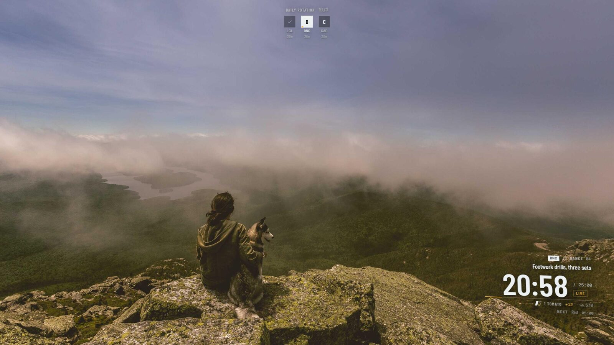
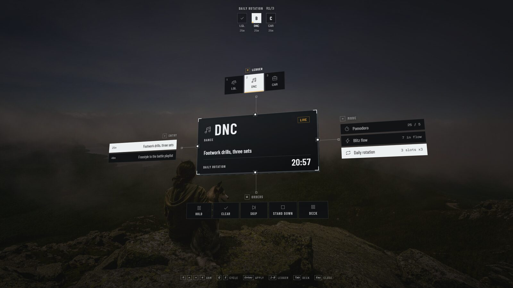
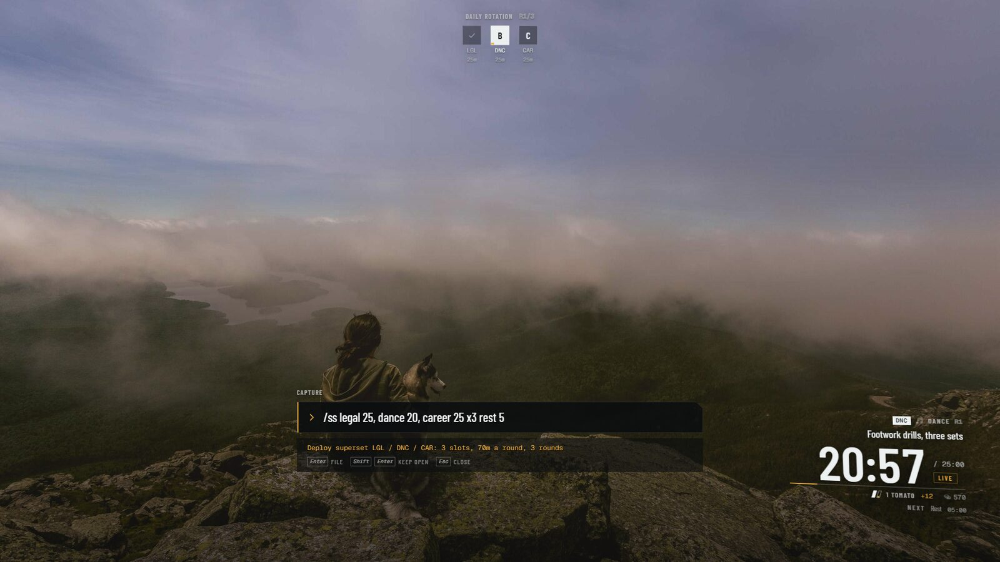
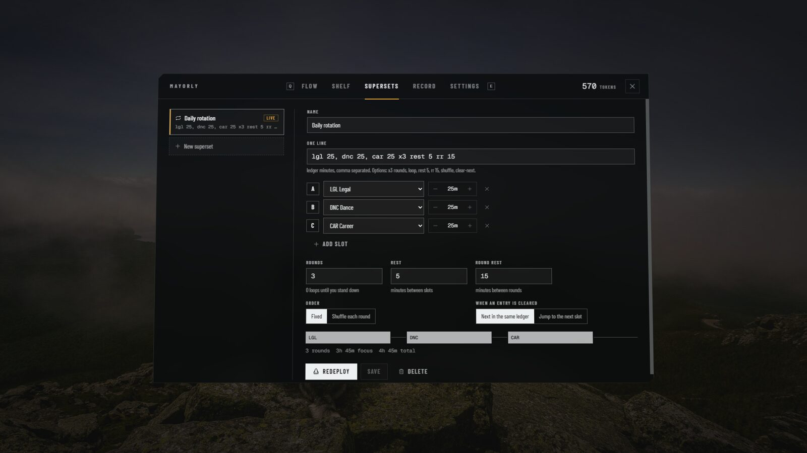

# Mayorly app

The application layer of **Mayorly**, for Windows and macOS. A transparent focus HUD that sits on top of whatever you are doing, runs your day as one continuous flow, and rotates between the things you care about on rules you write.

It is the architecture north star for the whole project: the entries, ledgers, desk, tomatoes and tokens from [mayorly-design](https://github.com/shane1595042264/mayorly-design) live here as a pure domain core, and the HUD is the first client of it. The pixel-art Mayor's Hall from [mayorly-assets](https://github.com/shane1595042264/mayorly-assets) becomes a second client later, on the same core.



## What it does

- **Lock in on one thing.** Pick an entry or a ledger and deploy. At rest the HUD is only the founder's tomato holding one number: the countdown while a block runs, today's tomatoes when the desk is idle. Hover it for one line on what the desk is doing. On a Mac, drag the tomato to put it where you like.
- **Continuous flow, like Blitz.** Blitz mode runs your flow top to bottom. Clear an entry and the next one is already running, timed against its own estimate. No list to go back to.
- **Pomodoro, like Focus To-Do.** Focus and rest cycles with a long rest every fourth, on any entry or on a ledger alone ("Dance time, no entry").
- **Supersets: your own rotation rules.** Legal 25, Dance 20, Career 25, three rounds, five minutes of rest between, fifteen between rounds. The desk switches on its own. Order can be fixed or shuffled per round, and you choose what happens when you clear an entry mid-block.
- **Swap in real time.** Hold or tap **Alt+T** for the Plus menu: the loadout floats in 3D with four attachment arms around it. Ledger up, entry left, mode right, orders down. Press **1-9** to jump ledgers, or click. The block timer keeps running through a swap; only the work changes.
- **Tracks time.** Every second of desk time is a segment against an entry and a ledger. The Record tab shows today by ledger, the last seven days, and the clerk's log.
- **Tokens, by the spec.** 12 per tomato, 18 each once a sitting reaches three. Earned only at the desk. Nothing decays, no streaks, an explicit hold.



## Hotkeys

Global, from any app. All of them can be changed in Deck, Settings. On a Mac, Alt is the Option key; the HUD shows them that way.

| | |
|---|---|
| **Alt+T** | Plus menu. Tap to toggle, or hold to peek and release to close. |
| **Alt+N** | Capture. Type, Enter, it lands in the flow. |
| **Alt+M** | Deck: flow, shelf, supersets, record, settings. **Q / E** switch tabs. |
| **Alt+P** | Hold and resume the desk. |
| **Alt+H** | Hide or show the HUD. |

Inside the Plus menu: arrow keys or WASD pick an arm, **Q / E** cycle, **Enter** applies, **1-9** jump to a ledger, **Tab** opens the deck, **Esc** closes.

On Windows the overlay is click-through in field mode: only the tomato catches the pointer. On a Mac the window is just the pet, so there is nothing to click through. Either way it never takes keyboard focus in field mode, so it cannot steal a keystroke from what you are working in.

## Capture and the command line

Plain text is an entry. The mute clerk files it:

```
legal: reply to the landlord ~20      files to LGL, 20 minute estimate
footwork drills #dnc ~1h              files to DNC by tag, 60 minutes
book a haircut                        lands in the tray, no ledger named
```

A leading slash is an order:

```
/ss legal 25, dance 20, career 25 x3 rest 5 rr 15     write a superset and deploy it
/pomo dance        /blitz        /hold        /go        /skip        /stand
```

Superset options: `x3` rounds, `loop` until you stand down, `rest 5`, `rr 15` between rounds, `shuffle`, `clear-next` to jump to the next slot when an entry is cleared.



## Install

**Windows.** Download `Mayorly-Setup-<version>.exe` or the portable exe from [Releases](https://github.com/shane1595042264/mayorly-app/releases). The build is unsigned, so Windows SmartScreen will warn on first run: More info, Run anyway.

**macOS 13 or later.** Download `Mayorly-<version>-arm64.dmg` (Apple silicon) or `Mayorly-<version>-x64.dmg` (Intel) from the same page, drag Mayorly to Applications and open it. The build is signed ad hoc and not notarized, because there is no Apple Developer ID yet, so macOS refuses the first launch. Open System Settings, Privacy & Security, scroll to Security, click Open Anyway, then open Mayorly again. The button stays for about an hour after the refused launch. If Open at login does not take on this build, add Mayorly under System Settings, General, Login Items.

Mayorly lives in the tray, the menu bar on a Mac. Right-click it on Windows, or click it on a Mac, for the display picker (it runs on one monitor at a time), open at login, and the data folder.

Your data is one JSON file, written atomically: `%APPDATA%\Mayorly\mayorly.json` on Windows, `~/Library/Application Support/Mayorly/mayorly.json` on macOS. Nothing leaves the machine unless you sign in.

## The clerk

Deck, Settings, AI clerk: paste one API key from Anthropic, OpenAI, Google Gemini or xAI. The provider is read from the key's shape, its models are listed and the cheapest one is made to answer once; you can pick another. From then on the clerk files every captured line by your ledgers' criteria, trims the title and reads the estimate, and sweeps the tray on launch, after each capture, and when you press Auto-classify in the Flow. Keys stay on this machine. Without a key, the clerk files by prefix and tag only.

Move an entry the clerk filed and the correction becomes a house rule in your words, which the clerk reads before every filing. Rules are edited in Settings and sync with your account.

## Account and sync

Deck, Settings, Account: **Sign in with Google**. The browser opens for Google, and from then on your ledgers, entries, supersets and record live on the sync server too and follow you to every machine you sign in on. Hotkeys, HUD side and scale, open at login and sound stay per machine. Last writer wins: if two machines change things at once, the one that reached the server first keeps its version. A desk left running on one machine arrives paused on the other. Sign out any time; the local file stays.

The server is `server/` in this repo (`mayorly-api` on Railway, one state document per account). A build without a server configured simply has no Account section.

## Build from source

```bash
npm install
```

```bash
npm run dev
```

| | |
|---|---|
| `npm run dev` | the Electron app with hot reload |
| `npm run web` | the HUD alone in a browser at `localhost:5199`, running the same engine in the page. Add `?demo` for sample data, `?fresh` for a first run |
| `npm test` | domain core tests |
| `npm run typecheck` | TypeScript over everything |
| `npm run dist` | the installer for the platform you are on, into `dist/` |
| `npm run dist:win` | Windows installer and portable exe (builds on a Mac too) |
| `npm run dist:mac` | macOS disk images and zips for Apple silicon and Intel (macOS only) |
| `npm run icon` | rebuild every icon from the founder's hand-drawn tomato, no tools needed |

Pushing a `v*` tag runs the GitHub Actions workflow in `.github/workflows/dist.yml`, which builds both platforms and attaches them as workflow artifacts.

## How it is put together

```
src/core      the domain: entries, ledgers, desk, planner, tokens, clerk. Pure, tested, no Electron, no DOM.
src/main      the shell: owns the one true state, heartbeat, persistence, overlay window, hotkeys, tray.
src/preload   the bridge, nothing else.
src/renderer  the HUD: field HUD, Plus menu, deck, capture. A client of the bridge.
src/shared    the Bridge contract every client speaks.
```

The full picture, including how the pixel game and the mod API plug in, is in [docs/architecture.md](docs/architecture.md). Every non-obvious choice is in [docs/decisions.md](docs/decisions.md).



## Credits

- App icon: the founder's hand-drawn `icon.tomato` from mayorly-assets, scaled by whole pixels.
- Type: Barlow Condensed and Geist Mono, both under the SIL Open Font License, bundled through Fontsource.
- Icons: Phosphor.
- The HUD language is inspired by Battlefield 2042's HUD and Plus system. No game assets are used.
